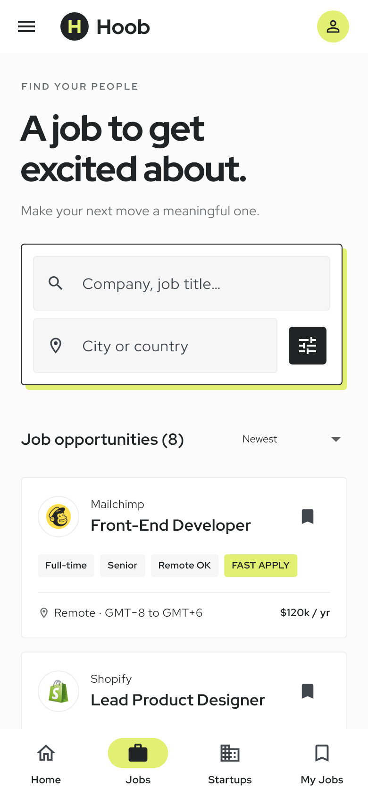
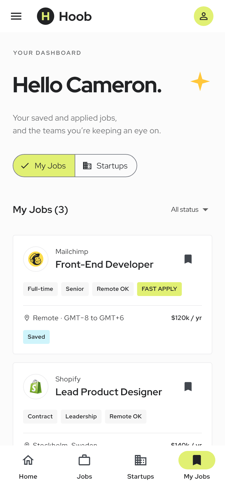

# Hoob · Flutter App

依据 Pixso 文件 **Hoob - Job Finder Website UI Kit** 开发的创业求职应用。保留黑白、黄绿强调色、硬边框偏移阴影与原稿照片，将 14 个网页界面适配为手机页面，另补充公司／投资机构详情。

支持 Android、iOS 项目和 Web 预览。当前交付是可运行的本地 UI 演示：搜索、筛选、排序、收藏、申请表校验、简历选择、申请记录和草稿保存均可操作；没有接入真实职位服务、登录、邮件或投递接口。

## 主要界面

| 首页 | 职位搜索 | 我的职位 |
| --- | --- | --- |
|  |  |  |

## 开始运行

环境：Flutter 3.47.7 / Dart 3.13.5。安装依赖后选择设备运行：

```sh
flutter pub get
flutter run
```

浏览器预览：`flutter run -d chrome`。Android 安装包：`flutter build apk --release --target-platform android-arm64 --split-per-abi`。iOS 构建需要 macOS、Xcode 与相应签名配置。

```sh
flutter analyze
flutter test test/app_test.dart
```

常规测试与图片导出分开运行。重新导出截图可使用 `flutter test --dart-define=CAPTURE_SCREENSHOTS=true test/app_test.dart`，输出到 `docs/screenshots/app/`。截图使用固定的示例收藏和申请数据，不会写入实际安装应用的数据。

## 文档与资源

- [项目结构、架构与页面说明](docs/项目说明.md)
- [全部界面截图与原稿对照](docs/截图索引.md)
- [验证记录](docs/验证记录.md)
- [Pixso 节点与素材清单](docs/design-manifest.json)
- [字体与设计素材说明](docs/素材说明.md)

业务代码集中在 `lib/`：按功能分目录，公共界面组件放在 `shared/`，样式放在 `core/`，示例数据和本机状态放在 `data/`。运行依赖仅 `shared_preferences` 和 `file_picker` 两项。
