# 界面截图索引

## 业务页面与原稿对照

应用截图是 Flutter 组件树在 390 × 844 逻辑像素下的实际渲染，输出为 780 × 1688 PNG。原稿截图按宽度 720 像素导出，保留完整画板。个人面板采用固定测试收藏／申请数据，正式首次运行从空状态开始。

| 序号 | 界面 | Flutter 截图 | Pixso 原稿 |
| --- | --- | --- | --- |
| 1 | 首页 | [查看](screenshots/app/01-home.png) | [查看](screenshots/design/01-home.png) |
| 2 | 职位搜索 | [查看](screenshots/app/02-find-jobs.png) | [查看](screenshots/design/02-find-jobs.png) |
| 3 | 职位详情 | [查看](screenshots/app/03-job-details.png) | [查看](screenshots/design/03-job-details.png) |
| 4 | 创业公司目录 | [查看](screenshots/app/04-browse-startups.png) | [查看](screenshots/design/04-browse-startups.png) |
| 5 | 融资与投资机构 | [查看](screenshots/app/05-seek-funding.png) | [查看](screenshots/design/05-seek-funding.png) |
| 6 | 投资者介绍 | [查看](screenshots/app/06-for-investor.png) | [查看](screenshots/design/06-for-investor.png) |
| 7 | 创业者介绍 | [查看](screenshots/app/07-for-startups.png) | [查看](screenshots/design/07-for-startups.png) |
| 8 | 平台介绍 | [查看](screenshots/app/08-company.png) | [查看](screenshots/design/08-company.png) |
| 9 | 文章列表 | [查看](screenshots/app/09-blogs.png) | [查看](screenshots/design/09-blogs.png) |
| 10 | 文章详情 | [查看](screenshots/app/10-blog-details.png) | [查看](screenshots/design/10-blog-details.png) |
| 11 | 联系表单 | [查看](screenshots/app/11-contact.png) | [查看](screenshots/design/11-contact.png) |
| 12 | 申请表 | [查看](screenshots/app/12-apply.png) | [查看](screenshots/design/12-apply.png) |
| 13 | 申请成功状态 | [查看](screenshots/app/13-application-sent.png) | [查看](screenshots/design/13-application-sent.png) |
| 14 | 我的职位 | [查看](screenshots/app/14-my-jobs.png) | [查看](screenshots/design/14-my-jobs.png) |

## 补充界面与适配验证

| 截图 | 内容 |
| --- | --- |
| [公司详情](screenshots/app/15-startup-profile.png) | 公司资料、收藏和关联职位 |
| [职位筛选](screenshots/app/16-job-filters.png) | 角色、资历、工作类型、远程、薪资面板 |
| [桌面首页](screenshots/app/17-desktop-home.png) | 1280 × 900 逻辑像素，双栏布局 |
| [平板职位](screenshots/app/18-tablet-jobs.png) | 768 × 1024 逻辑像素 |
| [投资档案草稿](screenshots/app/19-local-investor-profile.png) | 本机保存成功状态 |
| [联系草稿](screenshots/app/20-contact-saved.png) | 本机留言保存成功状态 |

## 设计规范分类

| 分类 | 截图 |
| --- | --- |
| 字体规范 | [Typography](screenshots/design/style-typography.png) |
| 颜色规范 | [Colors](screenshots/design/style-colors.png) |
| 文件封面 | [Thumbnail](screenshots/design/cover.png) |

## 页面预览

### 首页

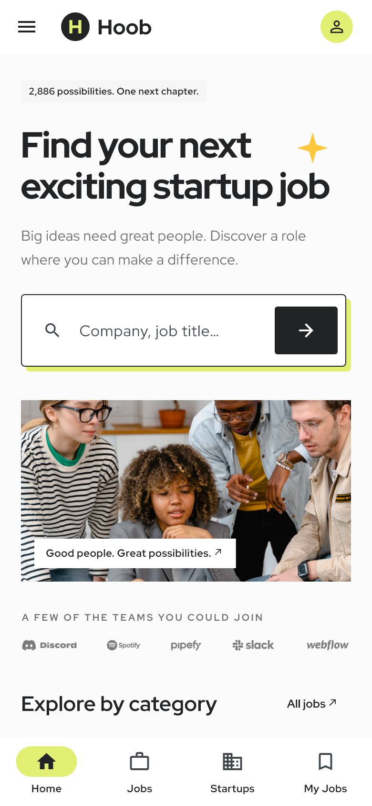

### 职位搜索

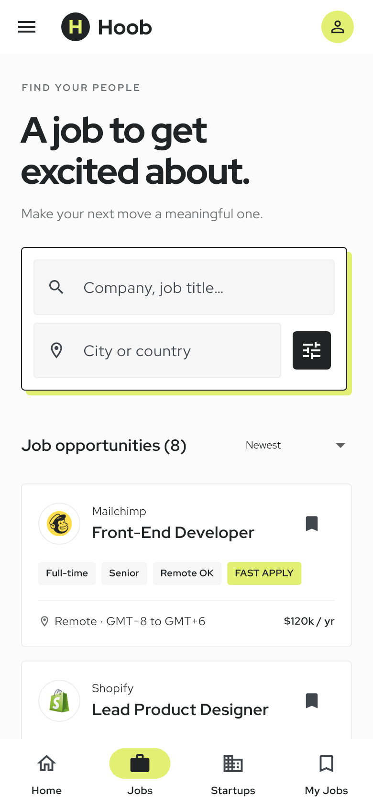

### 职位详情

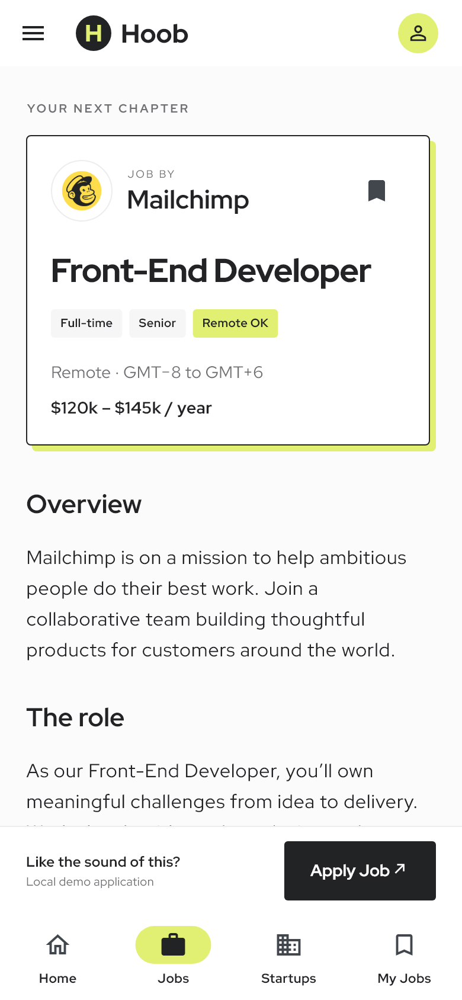

### 创业公司目录

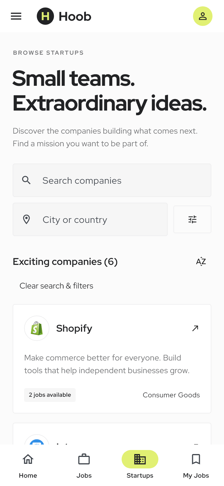

### 融资与投资机构

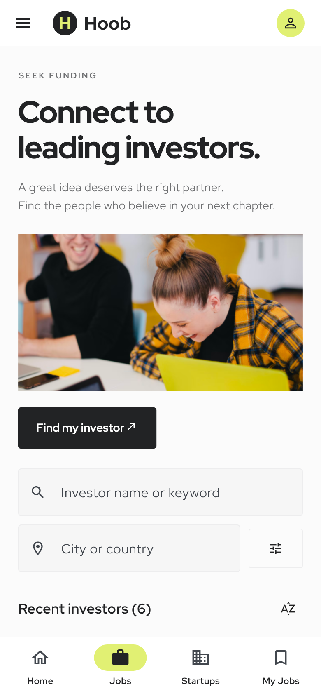

### 投资者介绍

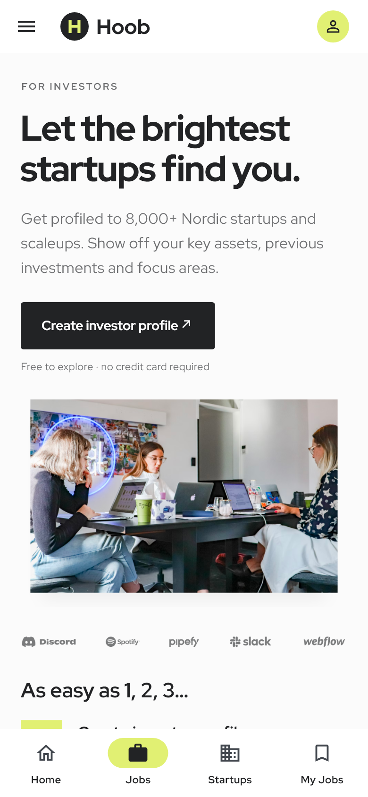

### 创业者介绍

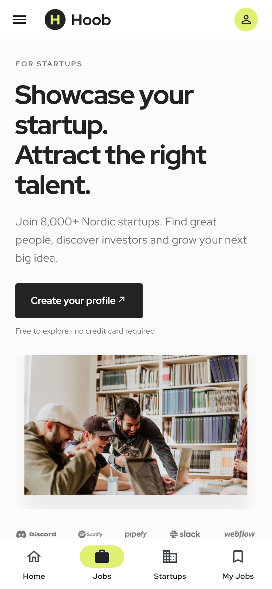

### 平台介绍

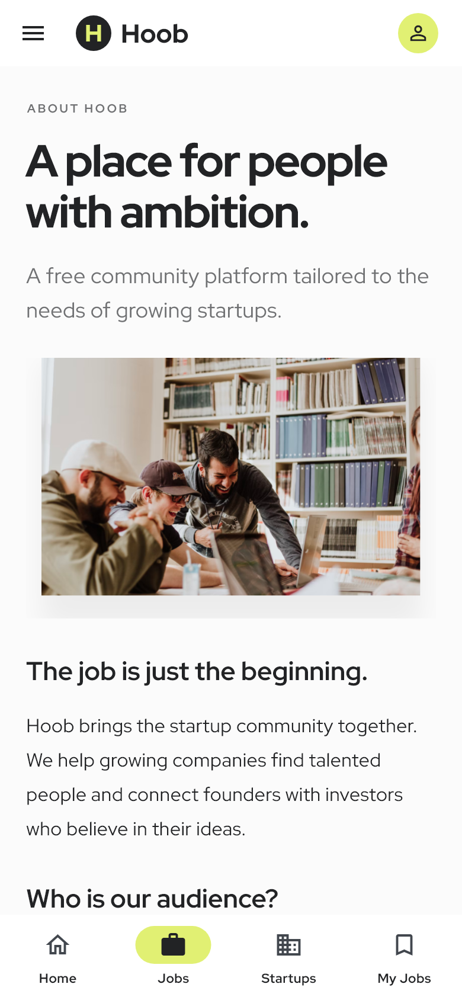

### 文章列表

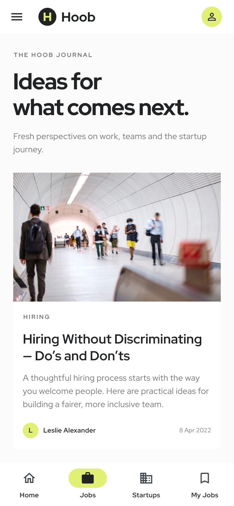

### 文章详情

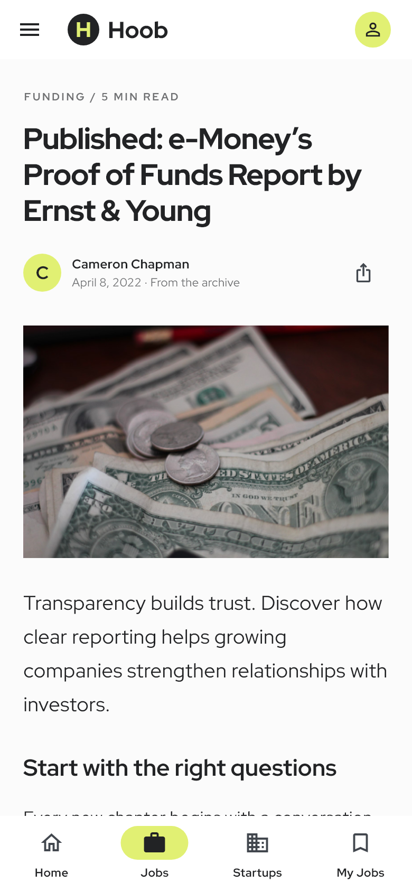

### 联系表单

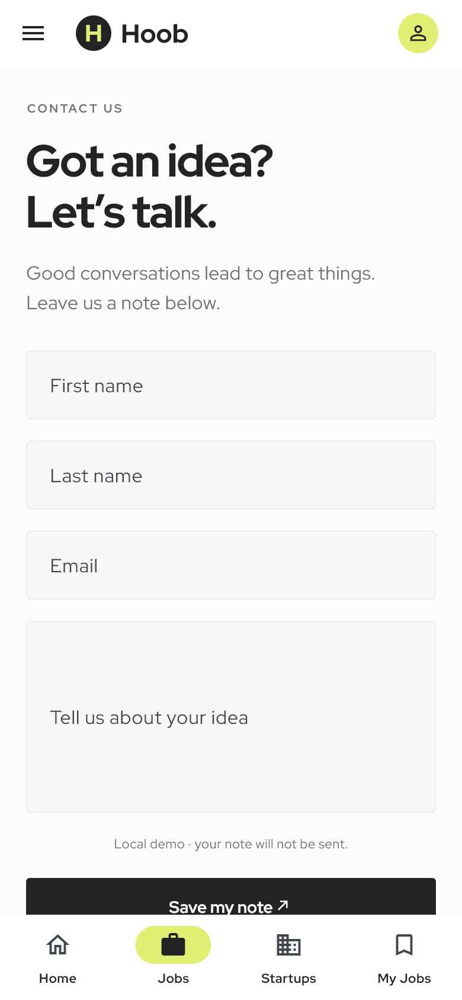

### 申请表

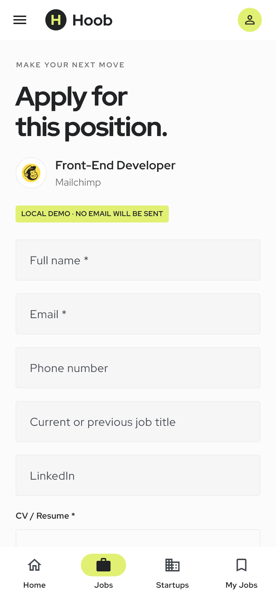

### 申请成功状态

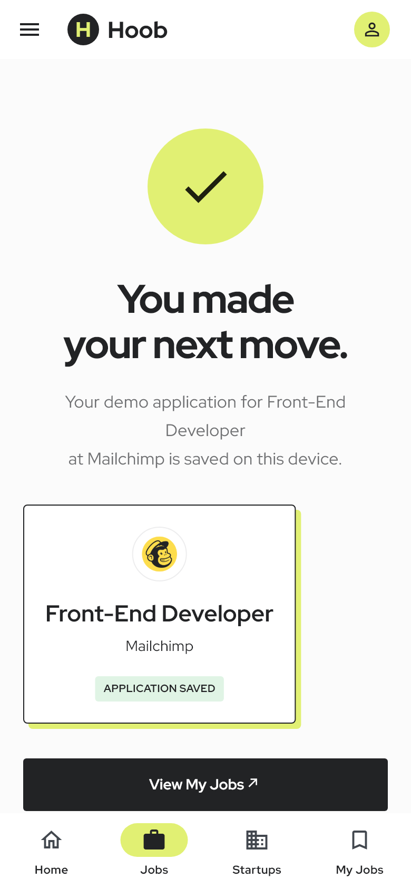

### 我的职位

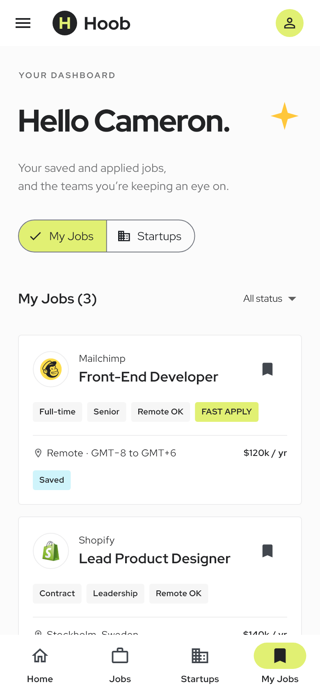


## 重新生成

在项目根目录运行：

```sh
flutter test --dart-define=CAPTURE_SCREENSHOTS=true test/app_test.dart
```

测试会预加载照片和图标字体后截图，避免出现空白照片或缺字。截图中的英文遵循原稿语言；项目说明文档使用中文。截图验证覆盖页面首屏，长页面可在运行中的应用内滚动查看。

