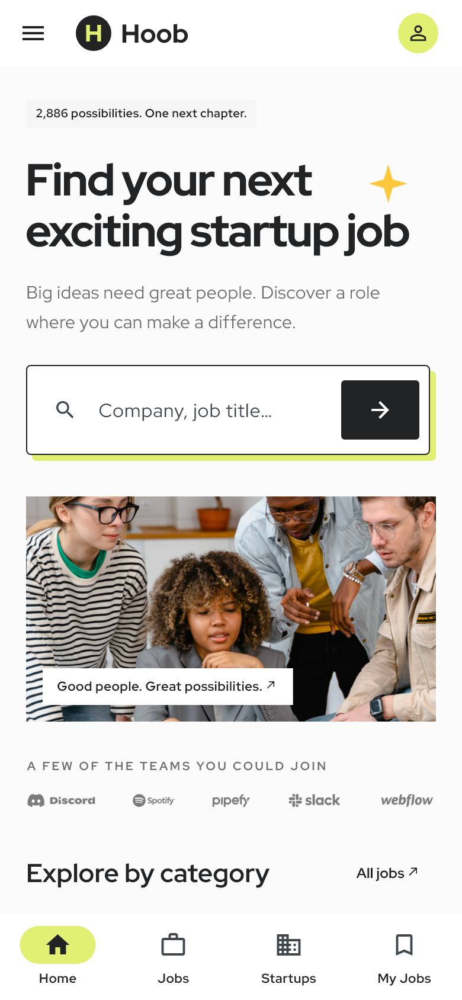
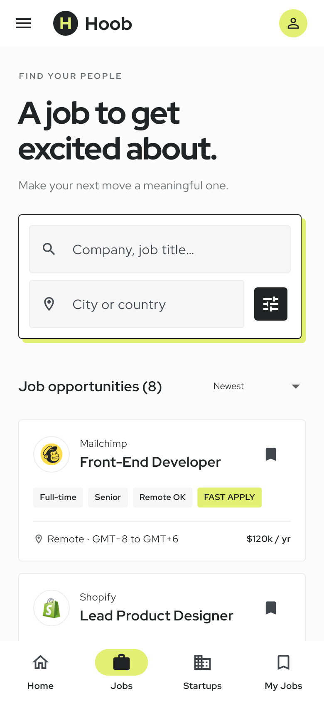
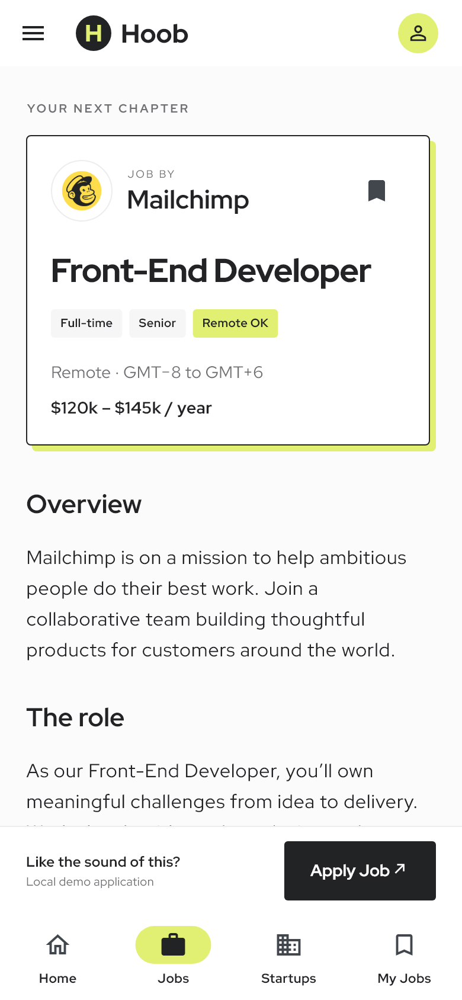
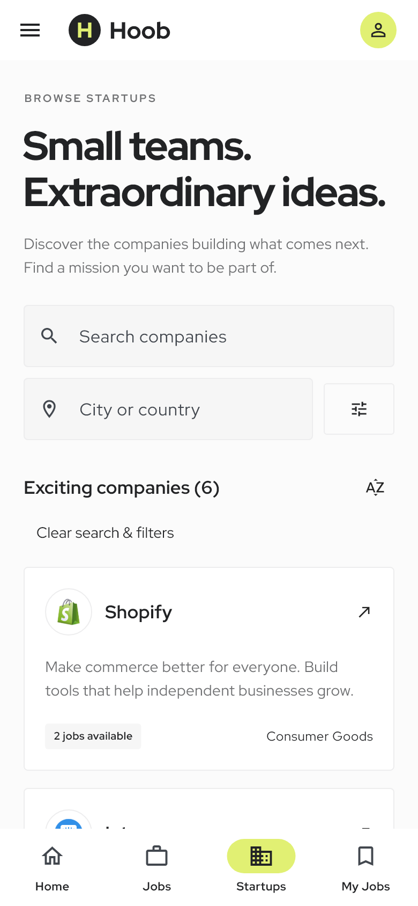
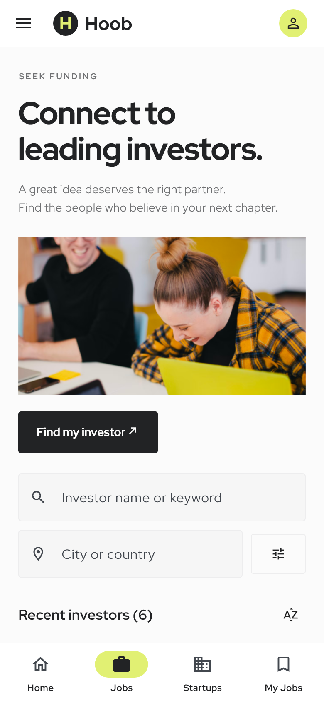
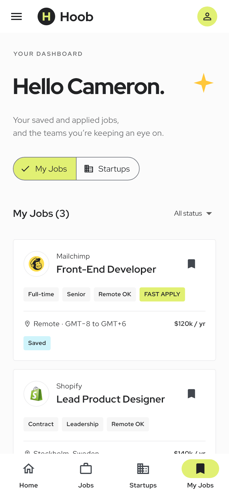
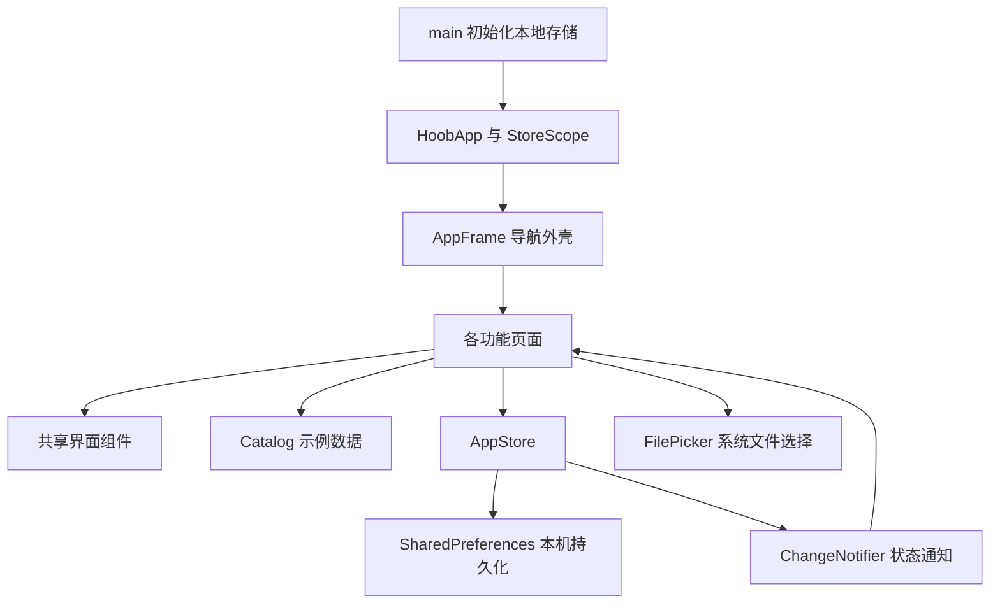

# Hoob Flutter 项目说明

## 1. 项目内容

Hoob 将创业求职者、创业公司与投资机构放在同一应用中。用户可发现职位、筛选公司、寻找投资机构、阅读文章，并在个人面板集中查看收藏与本地申请记录。

设计来源为当前 Pixso 文件 **Hoob - Job Finder Website UI Kit**。已检查全部三个页面分类：

| Pixso 分类 | 内容 | 实现方式 |
| --- | --- | --- |
| Design，`0:1` | 14 个业务画板 | 全部对应到 Flutter 页面或操作状态 |
| Component & StyleGuide，`242:533` | 字体、颜色、按钮、卡片、输入框、页头、页脚、Logo、图标 | 提取为主题及公共组件；另保存字体与颜色规范截图 |
| Thumbnail，`1040:22015` | 文件封面 | 归档参考图，不作为业务页面 |

原稿是 1440 像素桌面网站，本项目以手机为主进行适配，而不是将网页按比例缩小。保留照片、标志、主色、字体特征、描边及偏移阴影；手机使用底部导航、抽屉菜单、单列列表和底部筛选面板。申请和成功弹窗转换为独立页面，以适应键盘和小屏滚动。

## 2. 主要界面

### 首页与职位发现

| 首页 | 职位列表 | 职位详情 |
| --- | --- | --- |
|  |  |  |

首页提供关键词入口、角色分类、热门公司及城市入口。职位页支持标题／公司搜索、城市搜索、岗位类别、资历、工作类型、远程、最低年薪筛选，以及薪资排序。结果数根据真实筛选结果计算；无匹配时提供清空入口。

### 创业生态与个人面板

| 创业公司 | 融资目录 | 我的职位 |
| --- | --- | --- |
|  |  |  |

公司目录可按行业、阶段、规模、远程及融资状态筛选。投资目录可按行业、阶段、机构类型及投资金额上限筛选。进入机构／公司详情后可收藏，或查看相应公司的职位。“我的职位”支持查看全部、已收藏和已申请，以及收藏的公司／机构。

完整截图及原稿链接见 [截图索引](截图索引.md)。应用截图通过 Flutter 实际组件树渲染生成，并非设计稿拼接。展示收藏和申请状态的截图使用测试夹具；首次安装应用的个人面板为空。

## 3. 页面映射

| 原稿画板 | Flutter 路由 | 页面功能 |
| --- | --- | --- |
| 1. Home | `/` | 首页、搜索入口、分类、公司与城市 |
| 2. Find Jobs | `/jobs` | 搜索、筛选、排序、职位卡片 |
| 3. Jobs Details | `/job` | 职位介绍、要求、公司入口、收藏、申请 |
| 4. Browse Startups | `/startups` | 公司目录及筛选 |
| 5. Seek Fundings | `/funding` | 融资介绍、投资机构搜索与筛选 |
| 6. For Investor | `/for-investor` | 投资人介绍、三步指引、权益、FAQ、本地档案草稿 |
| 7. For Startup | `/for-startups` | 创业者介绍、指引、权益、社区、FAQ、本地档案草稿 |
| 8. Company | `/company` | 平台介绍、受众、社区及合作伙伴 |
| 9. Blogs | `/blogs` | 文章推荐、类别筛选、文章列表 |
| 10. Blog Details | `/article` | 文章阅读、复制标题、相关阅读 |
| 11. Contact Us | `/contact` | 联系表单校验、保存及恢复本地草稿 |
| 12. Form Apply | `/apply` | 申请表、简历文件选择、校验 |
| 13. Application Sent | `/sent` | 本地申请成功状态、个人面板入口 |
| 14. My Jobs | `/my-jobs` | 收藏、申请状态、机构收藏 |
| 补充详情页 | `/organization` | 公司／投资机构资料及关联职位 |

详情页通过路由参数传递 `Job`、`Article` 或 `Organization`。首页分类与城市入口会携带初始查询条件进入职位页。主导航使用首页、职位、创业公司、我的职位四项；抽屉可访问全部主要业务页面。

## 4. 项目结构

```text
HoobJobFinderWebsite/
├── lib/
│   ├── main.dart                      # 初始化偏好存储和系统栏
│   ├── app.dart                       # 应用主题注入、路由及参数分派
│   ├── core/
│   │   └── theme.dart                 # 设计色、字号、按钮、输入框及导航主题
│   ├── data/
│   │   ├── catalog.dart               # Job、Organization、Article 及示例内容
│   │   └── app_store.dart             # 可观察状态、本机持久化、草稿读写
│   ├── shared/
│   │   ├── app_frame.dart             # 页头、抽屉、底部导航
│   │   └── widgets.dart               # 卡片、标签、网格、空状态、页脚
│   └── features/
│       ├── home/home_page.dart
│       ├── jobs/
│       │   ├── jobs_page.dart         # 列表、筛选状态及筛选面板
│       │   └── job_detail_page.dart
│       ├── explore/
│       │   ├── directory_page.dart    # 公司／投资目录及机构详情
│       │   └── marketing_pages.dart   # 投资／创业介绍、平台介绍、FAQ 与档案草稿
│       ├── journal/journal_pages.dart
│       └── account/
│           ├── application_pages.dart
│           ├── my_jobs_page.dart
│           └── contact_page.dart
├── assets/
│   ├── images/                       # 从 Pixso 导出的照片、公司标志、合作伙伴与 Logo
│   └── fonts/                        # 三个静态字重及 OFL 许可
├── test/app_test.dart                 # 页面渲染、截图及主要交互测试
├── android/                          # Android 宿主工程
├── ios/                              # iOS 宿主工程
├── web/                              # Web 启动入口与应用图标
├── docs/
│   ├── 项目说明.md
│   ├── 截图索引.md
│   ├── 验证记录.md
│   ├── 素材说明.md
│   ├── design-manifest.json
│   └── screenshots/
│       ├── design/                   # Pixso 原稿截图
│       └── app/                      # Flutter 页面截图
├── pubspec.yaml
└── pubspec.lock
```

## 5. 架构与数据流



采用按功能组织的轻量结构。页面负责展示和临时表单／筛选状态；`AppStore` 负责跨页面状态与持久化；`catalog.dart` 负责类型化的示例数据。`StoreScope` 基于 Flutter 自带的 `InheritedNotifier`，订阅收藏、申请记录等变化，无需额外状态管理库。

筛选条件只属于当前列表页面，取消底部面板不会覆盖已应用条件。保存职位／公司后通知订阅页面更新。成功保存申请后，路由替换为结果页；个人面板从同一 `AppStore` 读取数据，重新启动后也能恢复。

| 数据 | 保存位置／方式 | 行为 |
| --- | --- | --- |
| 收藏职位 | `savedJobs` 字符串列表 | 再次点击取消收藏 |
| 收藏公司／机构 | `savedCompanies` 字符串列表 | 个人面板的 Startups 分类查看 |
| 本地申请 | `applications` JSON | 按职位 ID 去重，保存时间 |
| 申请人名字 | `name` | 用于个人面板问候 |
| 相似职位偏好 | `similarJobUpdates` | 仅保存偏好，不发送通知 |
| 创业／投资档案草稿 | `startupDraft` / `investorDraft` JSON | 再次打开表单时恢复 |
| 联系草稿 | `contactDraft` JSON | 保存在当前设备，重新进入可编辑 |

照片、字体与目录数据均打包到应用中，主要页面无需联网。没有第三方账号与远程数据同步。

## 6. 表单与边界

申请表要求姓名、有效邮箱和简历；LinkedIn 可选，填写时校验完整 HTTP(S) 地址。文件选择限定 PDF、DOC、DOCX 且最大 10 MB。取消选择保持当前状态，文件异常或过大时显示提示。

本地演示仅保存职位 ID、时间、名字及偏好。邮箱、电话、LinkedIn、职位经历和简历文件不会上传；简历不复制到项目目录。联系表单和机构档案则明确以草稿形式保存其字段，便于下次恢复。

原稿里部分统计数字是占位内容，本实现将列表数字改为当前示例数据量与筛选结果。示例内容包括 8 个职位、6 家公司、6 家投资机构和 4 篇文章。文章保留原稿中的部分标题和归档日期，正文整理为 UI 阅读示例，不提供法律或投资建议。品牌及职位内容不代表相应公司正在招聘或接受投资申请。

## 7. 视觉与适配

- 主色 `#E1F073`，正文 `#222325`，底色 `#FBFBFB`，分隔线 `#EDEDEE`，辅助色 `#FFC73B`。
- 以 Red Hat Display 的 400、700、800 静态字重为基础，字体衍生命名为 Hoob Display，加入应用使用的箭头和四角星字形，避免测试环境缺字。
- 硬描边与 5 像素偏移阴影用于搜索区和重点内容，不将整屏做成图片。
- 小屏卡片单列；宽屏网格自动变为两至三列；首页大屏使用双栏。
- 表单可滚动，并适应键盘；职位详情的申请按钮固定在内容区底部。
- 每个输入控制器随页面销毁释放；复用公司／投资目录、营销页面、卡片、网格和主题，减少重复代码。

## 8. 运行、测试和扩展

```sh
flutter pub get
flutter run                  # 选择连接的手机或模拟器
flutter run -d chrome        # Web 预览
flutter analyze
flutter test test/app_test.dart
flutter build apk --release --target-platform android-arm64 --split-per-abi
```

iOS 工程已提供，需在 macOS 上使用 Xcode 配置签名、构建及验证。演示 Android 发布包使用开发签名；正式上架前需配置正式签名和业务服务。

后续接真实业务时，可将 `catalog.dart` 的静态数据来源替换为数据服务，并将 `AppStore` 的本地申请动作连接到投递接口；界面组件可以沿用。登录、真实投递、上传、消息通知、远端资料发布和账户同步均不在当前本地 UI 交付范围。

本次实际验证情况见 [验证记录](验证记录.md)。
